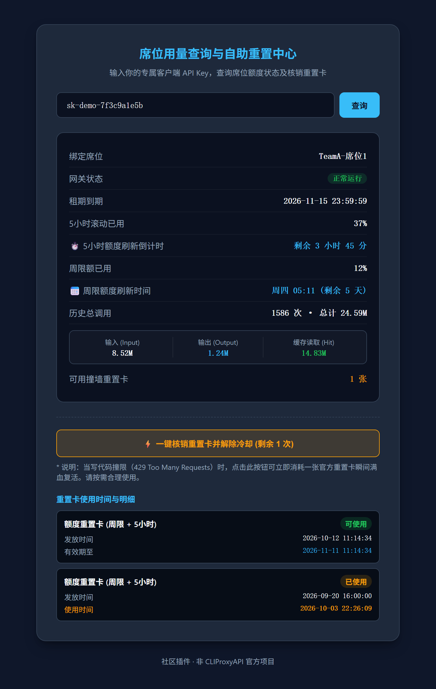
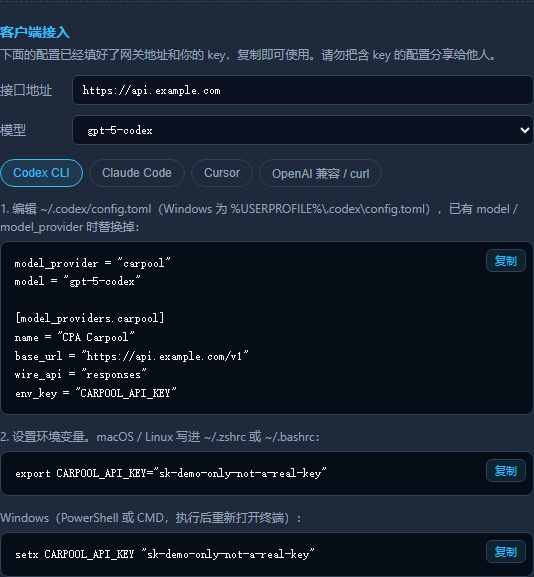
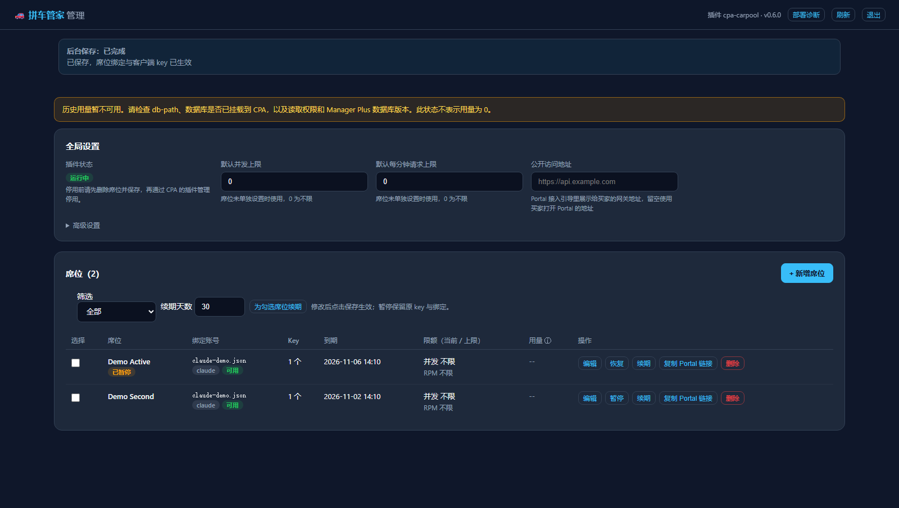
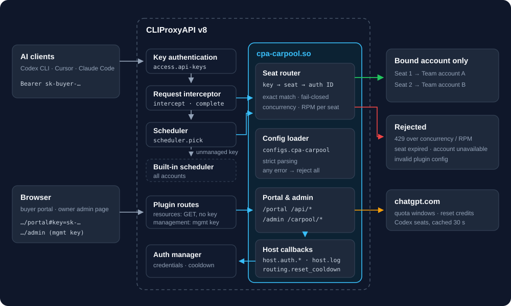
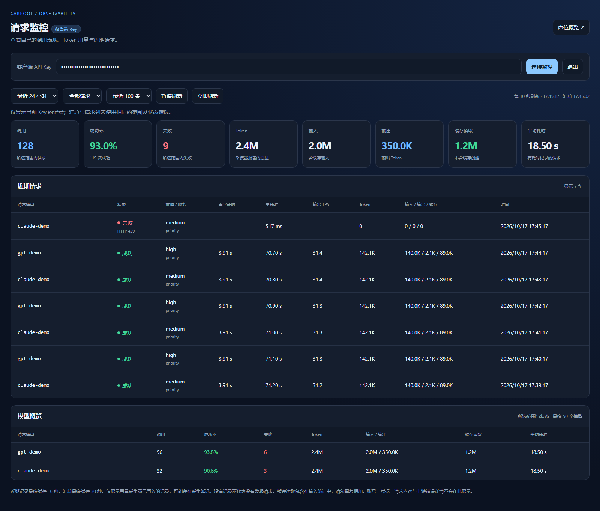

<div align="center">

# 🚗 cpa-plugin-carpool

**A lightweight multi-tenant seat plugin for [CLIProxyAPI](https://github.com/router-for-me/CLIProxyAPI) (CPA)**

*One key, one account · Per-seat concurrency / RPM limits · Self-service quota portal and client setup · Self-service reset credits · Owner admin page · Fail-closed configuration*

[](https://github.com/212duo/cpa-plugin-carpool/actions/workflows/ci.yml)
[](./LICENSE)


[简体中文](./README.md) · **English**

The current release is [v0.6.0](https://github.com/212duo/cpa-plugin-carpool/releases/tag/v0.6.0), with backend save jobs, seat pause and bulk renewal, deployment diagnostics and configuration safety behind reverse proxies.

[Quick start](#-quick-start) · [Configuration](#-configuration-reference) · [Security](#-security-design) · [Known limitations](#-known-limitations) · [Spec (SPEC.md, Chinese)](./SPEC.md) · [Changelog](./CHANGELOG.md)

</div>

> [!WARNING]
> **This is a community project with no affiliation to CLIProxyAPI, OpenAI or Anthropic.** The terms of most AI services forbid sharing or transferring accounts, and using this plugin may get your accounts restricted or banned. Quota lookup and reset-credit redemption rely on undocumented ChatGPT endpoints that can break at any time. Read the [disclaimer](#-disclaimer) first; you use this plugin at your own risk.

---

## 💡 What problem does it solve

When a few people share a ChatGPT Team seat, or a small team hands out accounts, the usual options all fall short:

* **Sub2API / NewAPI style gateways are heavy**: they need a database, Redis and separate services, which is too much to run for a handful of accounts;
* **Plain CPA has no multi-tenancy**: there is no quota page for the people using it, and routing plugins that match by email mix up accounts when one email has several (for example a Team seat and a personal Pro plan);
* **Hitting a limit means waiting for the admin**: on a 429 the user has to ask the admin to check the quota and reset it by hand.

This plugin runs inside CPA as a native shared library, with no database and no extra process. The admin binds each key to specific accounts and sets its limits on the admin page (or in `config.yaml`); users open the portal with their own key to see their quota and countdowns, copy ready-made client configs, and redeem a reset credit themselves when they hit the limit.

## ✨ Features

| Feature | Description |
| :--- | :--- |
| **Dedicated scheduling** | A key can only use the accounts bound to it; when they are cooling down or unavailable the request is rejected and **never falls back to other accounts** |
| **Exact binding** | Accounts are matched by their exact CPA auth ID, so a Team seat and a personal account under the same email never mix |
| **Lease expiry** | Each seat can have an `expire-at`; after it, scheduling and the portal reject the seat |
| **Seat limits** | Each seat can cap its concurrent requests and requests per minute (RPM); excess requests get a 429 with `Retry-After`, so no one can max out the shared account |
| **Fail-closed config** | A broken config makes the plugin reject every request and log the reason, instead of letting buyer keys fall through to the default scheduler and the whole account pool |
| **Buyer portal** | Usage and reset countdowns for the 5-hour and weekly windows, concurrency and RPM usage, reset credits, historical token usage |
| **Client setup guide** | The portal generates Codex CLI, Claude Code, Cursor and OpenAI-compatible client configs for the buyer's key, ready to copy |
| **Self-service reset** | Redeems an official reset credit and immediately clears the account's cooldown through a CPA host callback |
| **Owner admin page** | Add, edit and delete seats, generate random keys, bind accounts, set limits and leases, see account state and usage; changes are validated with the plugin's rules before saving |
| **Minimal exposure** | Responses to buyers only contain whitelisted fields; no email, account_id or tokens |

<table align="center">
  <tr>
    <td align="center"></td>
    <td align="center"></td>
  </tr>
  <tr>
    <td align="center"><sub>Buyer portal (demo data; the UI is in Chinese)</sub></td>
    <td align="center"><sub>Client setup guide in the portal</sub></td>
  </tr>
</table>

<p align="center">
  
  <br>
  <sub>Owner admin page (demo data)</sub>
</p>

## 🔧 How it works

<p align="center">
  
</p>

* **Scheduling**: the plugin registers as CPA's scheduler plugin. For each request it identifies the caller's key (CPA's `caller_scope`, or the `Authorization` / `x-api-key` header), finds the seat and picks only among the accounts bound to it. Keys that are not configured (such as your own) are handed back to CPA's default scheduler.
* **Limits**: as soon as any seat has a limit, the plugin also registers as a request interceptor. Every request passes its seat's limits before an account is picked and gets a 429 if it is over them; CPA tells the plugin when each request ends, which frees its concurrency slot.
* **Portal and admin page**: pages served through CPA's plugin resource routes. Buyer endpoints take the buyer's key; admin endpoints live under CPA's Management API and need the management key. Credentials and runtime cooldown state are read through CPA host callbacks, so the plugin never reads or writes the auth directory itself; the admin page saves through the plugin backend, which calls CPA's config API to write `config.yaml`.

## 📋 Compatibility

| Item | Requirement |
| :--- | :--- |
| CLIProxyAPI | **v8.0.30 or later** (plugin ABI v1; built and tested against SDK v8.0.30) |
| Platform | Linux amd64 / arm64, glibc ≥ 2.36 (the official `debian:bookworm` Docker image qualifies) |
| Scheduling | Accounts from any provider, including API-key accounts configured in `config.yaml` |
| Portal lookup | File-backed accounts (credential files created by OAuth login) |
| Quota and reset credits | **Codex (ChatGPT)** accounts only; for other file-backed accounts the portal shows seat status and token usage |
| Token history | Optional; needs the `usage.sqlite` of [CPA Manager Plus](https://github.com/seakee/CPA-Manager-Plus) |
| Admin page | Needs a CPA management key (`management.secret-key`); access from other machines also needs `management.allow-remote` |

## 🚀 Quick start

### 1. Get the plugin

**From CPA's plugin store** (once listed in the [official store](https://github.com/router-for-me/CLIProxyAPI-Plugins-Store)): search for `cpa-carpool` in the plugin store of CPA's management panel and install it. CPA downloads the release from this repository, verifies it against `checksums.txt` and installs it as `plugins/linux/<arch>/cpa-carpool-v<version>.so`. Then skip to step 3.

**Prebuilt**: download `cpa-carpool_<version>_linux_<amd64|arm64>.tar.gz` (or the `.zip` of the same name) for your architecture from [Releases](https://github.com/212duo/cpa-plugin-carpool/releases), extract `cpa-carpool.so` and verify it against `checksums.txt`.

**Or build it yourself** (needs Docker; the output matches the toolchain and glibc of the official image):

```bash
git clone https://github.com/212duo/cpa-plugin-carpool.git
cd cpa-plugin-carpool
sh build.sh          # writes out/cpa-carpool.so; pass "test" to run the tests first
```

### 2. Put it in CPA's plugin directory

Copy `cpa-carpool.so` into the directory configured as `plugins.dir` (by default `plugins/` under the working directory; a platform subdirectory such as `plugins/linux/amd64/` also works).

> The plugin ID is the file name without its extension and optional `-v<version>` suffix. **Keep the file name `cpa-carpool.so`** (or `cpa-carpool-v0.4.0.so`); both use `cpa-carpool` for the configuration section and resource URLs.

With the official Docker image, mount the plugin directory:

```bash
docker run -d -p 8317:8317 \
  -v $PWD/config.yaml:/CLIProxyAPI/config.yaml \
  -v $PWD/auths:/root/.cli-proxy-api \
  -v $PWD/plugins:/CLIProxyAPI/plugins \
  eceasy/cli-proxy-api:latest
```

### 3. Configure

Add the following to CPA's `config.yaml` (full example: [config.example.yaml](./config.example.yaml), comments in Chinese):

```yaml
access:
  api-keys:
    - "sk-owner-xxx"          # your own key: not in carpool, uses CPA's default scheduler
    - "sk-buyer-alice"        # buyer keys must be listed here too, or CPA rejects them before scheduling

plugins:
  enabled: true
  dir: "plugins"
  configs:
    cpa-carpool:
      enabled: true
      priority: 100
      rpm: 30                 # optional: default requests per minute per seat
      users:
        - name: "TeamA-seat1"
          api-keys: ["sk-buyer-alice"]
          primary: ["codex-xxxxxxxx-a1@example.com-team.json"]
          expire-at: "2026-11-15T23:59:59+08:00"
          max-concurrency: 2  # optional: at most 2 requests at a time for this seat
```

CPA pushes the new config to the plugin when it reloads `config.yaml`, so a restart is usually not needed. The CPA log shows the plugin being loaded; a bad config shows up as `[carpool] invalid plugin configuration ...`.

You can also write just `enabled: true` and add seats later on the [admin page](#-admin-page), which generates keys and updates both `access.api-keys` and the plugin config.

### 4. Send the portal link to the buyer

```text
https://your-domain/v0/resource/plugins/cpa-carpool/portal#key=sk-buyer-alice
```

Use the `#key=` form: everything after `#` stays in the browser and never reaches the server's access logs. The older `?key=` form still works, and the page removes it from the address bar after loading. The admin page has a "copy portal link" button for every seat.

Once the buyer opens the portal, its client setup section generates configs for Codex CLI (`~/.codex/config.toml`), Claude Code (`~/.claude/settings.json`), Cursor and OpenAI-compatible clients from their key, with models taken from the gateway's `/v1/models`. If clients reach the gateway at a different address than the one the portal is opened on (for example the portal is used on an internal network), set `public-base-url`.

## 🧰 Configuration reference

The config lives under `plugins.configs.cpa-carpool`. Parsing is **strict**: a misspelled field name is an error, not something silently ignored.

| Field | Type | Description |
| :--- | :--- | :--- |
| `enabled` | bool | When `false` the plugin handles nothing (every key uses CPA's default scheduler) |
| `priority` | int | Plugin priority read by CPA; with several scheduler plugins only the highest one runs |
| `debug` | bool | Log each scheduling decision to the CPA log (seat names only, never keys) |
| `db-path` | string | Path to CPA Manager Plus's `usage.sqlite`, visible inside the CPA process or container; auto-detected when empty. Missing or unreadable data is shown as unavailable |
| `upstream-user-agent` | string | User-Agent for the ChatGPT quota endpoints; empty uses the built-in default |
| `public-base-url` | string | The address clients use to reach the gateway (e.g. `https://api.example.com`), shown in the portal's setup guide; empty uses the address the portal was opened on |
| `max-concurrency` | int | Default concurrent request limit for seats that don't set one; `0` (default) means unlimited |
| `rpm` | int | Default requests-per-minute limit for seats that don't set one; `0` (default) means unlimited |
| `users[].paused` | bool | Pause the seat while retaining its keys and bindings; requests are explicitly rejected. Default `false` |
| `users[].name` | string | Seat name shown in the portal, **must be unique**; defaults to `seat-N` |
| `users[].api-keys` | []string | Keys assigned to the seat, **at least one**; a key may not appear in two seats |
| `users[].primary` | []string | Bound CPA auth IDs, **at least one**; exact match (case and `.json` suffix ignored) |
| `users[].expire-at` | string | Optional RFC3339 expiry, e.g. `2026-11-15T23:59:59+08:00` |
| `users[].max-concurrency` | int | Optional; overrides the default concurrency limit, `0` makes the seat unlimited |
| `users[].rpm` | int | Optional; overrides the default RPM limit, `0` makes the seat unlimited |

**If validation fails, the plugin rejects every request** (your own key included) and logs the reason. This is deliberate: if the plugin stepped aside instead, buyer keys would reach CPA's default scheduler and the whole account pool.

### Finding an auth ID (`primary`)

An auth ID is the account's credential file path **relative to CPA's auth directory** (`~/.cli-proxy-api` by default, set by `oauth.auth-dir`):

* use the file name in the auth directory, e.g. `codex-1a2b3c4d-alice@example.com-team.json`;
* include the subdirectory when the file is in one, e.g. `team/codex-1a2b3c4d-alice@example.com-team.json`;
* or call CPA's management API `GET /v0/management/auth-files` and use the file names it returns.

### Binding patterns

* **Several keys for one seat**: list them all under `api-keys`;
* **Several people sharing one account**: give several seats the same `primary`, each with its own keys and expiry;
* **One seat over several accounts**: list several `primary` IDs; scheduling picks among them by CPA priority, while the portal shows and resets the first one that is loaded.

### Request monitoring (0.5)

Click the monitoring button in the Portal, or open `https://your-domain/v0/resource/plugins/cpa-carpool/monitor` with your client key. Filter the last 1 hour / 24 hours / 7 days and successful / failed requests, inspect model summaries and the latest 100 / 500 records. The page refreshes every 10 seconds, pauses in background tabs, and supports horizontal table scrolling on phones.



* **Current key only:** the server verifies `X-Carpool-Key` and scopes every summary and record query to that key. Other keys in the same seat or sharing the same upstream account are excluded. Give each person a separate key; do not share or reassign old keys.
* **Minimal fields:** requested model, reasoning / service enums, success / failure, HTTP error code, tokens, first-token / total latency and timestamp. Account emails, auth files, keys / hashes, raw errors, request / response content, IPs and trace IDs are excluded. Missing requested models display an unavailable label; internal resolved models are never substituted.
* **Data source:** the same Manager Plus usage database described below. Only collected records appear, potentially with delay; in-flight and uncollected requests are unavailable. Costs are omitted until reliable pricing is available. Output TPS is estimated as output tokens / (total latency − first-token latency); missing or invalid values show `--`.
* **Access:** the monitoring API accepts only the `X-Carpool-Key` header. Page share links may use `#key=...`, never `?key=`. The page removes credentials from its address, keeps the key in memory, avoids browser storage, and clears data on key changes or logout. Use HTTPS for public access and protect share links.

#### Resource use and database index

Recent records are cached for 10 seconds; summaries and model groups for 30 seconds, with separate timestamps. Aggregates may be shared between list limits only for the same verified key, range and status. Keys never share cached results. Current authorization and expiry are checked before and after reading data; reconfiguration drops caches and cancels old queries. Errors are not cached and expired data is never used as a fallback.

Concurrent identical requests are coalesced, database connections are reused, and at most two monitoring data queries run across the plugin. Waiting and execution share a three-second deadline. The two caches hold at most 20 MiB of JSON data (excluding Go / SQLite and in-flight memory), with 256 response entries and 512 summary entries. Failed polling backs off to 20 / 40 / 60 seconds and returns to 10 seconds after recovery.

**For larger databases, run the index script once from the Manager Plus database's writable side.** The plugin remains read-only and never adds indexes automatically:

```bash
sqlite3 /actual/path/usage.sqlite < scripts/usage-monitor-index.sql
```

The index covers `(api_key_hash, timestamp_ms DESC, id DESC)` and the script is idempotent. Building it needs time and extra disk space; use a quiet period. A directory mounted read-only inside CPA cannot create it. Queries still work without the index, but initial aggregation can be slower on large datasets.

See [monitoring performance tests](docs/monitor-performance.md) for the reproducible million-row workload, scenarios and results.

### Token history

History comes from events already collected into CPA Manager Plus's `usage.sqlite`, separately from ChatGPT's quota windows. Installing this plugin alone does not create historical usage records.

* The portal shows the current key's records; the admin page aggregates all keys currently assigned to the seat. Counts include recorded successful and failed requests. Replaced or removed keys no longer contribute to that seat's totals.
* Both old and new database schemas are supported. New schemas use normalized input and cache-read counts; cache creation is not reported as a cache hit. No matching records means zero usage; a missing, unreadable or incompatible database means unavailable statistics.
* With separate Docker containers, mount Manager's complete data directory read-only into CPA, for example at `/opt/cpa/manager-data`, and set `db-path` to the path inside the CPA container. Include access to `usage.sqlite-wal` and `usage.sqlite-shm`; copying only the main database can miss recent events. Auto-detection cannot read files in another container.

## ⏳ Seat limits

When several people share one account, you can cap each seat's concurrent requests (`max-concurrency`) and requests per minute (`rpm`) so that no one uses up the account's quota or rate limits:

* Limits apply per **seat**: all keys of a seat share them, and seats don't affect each other.
* The top-level `max-concurrency` / `rpm` are defaults; a value on the seat wins, and `0` makes that seat unlimited.
* A request over the limit is rejected before any account is picked, with HTTP 429, a `Retry-After` header and a `rate_limit_error`; clients such as Codex CLI and Claude Code back off and retry.
* RPM is a sliding 60-second window counted by request start; a concurrency slot is freed when CPA reports the request's end (success, failure or cancellation). If that report is ever lost, the slot is reclaimed after 30 minutes at most.
* Counters live in CPA's process memory: they reset when CPA restarts and are not shared between CPA instances.
* Request interception and completion hooks are registered while at least one seat has a limit or is paused. With neither limits nor paused seats there is no request-hook overhead. Current limit usage is counted only while hooks are active.

## 🔑 Admin page

```text
https://your-domain/v0/resource/plugins/cpa-carpool/admin
```

For first-time setup, configure `management.secret-key`; access from another machine also requires `management.allow-remote: true`. The legacy section name `remote-management` remains supported.

Enter the plain-text management key on the page to:

* add, edit and delete seats, generate random keys (`sk-carpool-` + 48 hex characters), and copy keys or a buyer's portal link;
* bind accounts picked from those CPA has loaded (API-key accounts from `config.yaml` have to be typed in) and see which seats already use each account;
* set leases, seat limits and their defaults, `public-base-url` and debug logging;
* see each seat's account load and cooldown state, current concurrency, requests in the last minute and historical usage.

The page itself contains no data; everything is read with the management key, which is kept only in this browser tab (`sessionStorage`). Configuration and client keys use the plugin's `/v0/management/carpool/config` and `/v0/management/carpool/api-keys` endpoints; the browser does not need access to `/v8/`. On "save", the page previews seat additions, deletions and revoked-key counts, then submits one job to `POST /v0/management/carpool/save`. The Go backend validates the configuration and its persisted revision, then calls CPA's configuration API to:

1. revoke the keys of deleted seats from `access.api-keys` (first, so they can never fall through to the default scheduler and the whole pool);
2. confirm those keys fail CPA authentication, then write `plugins.configs.cpa-carpool`;
3. confirm the plugin has applied the new bindings, then add new keys to `access.api-keys`.

A failed step reports its stage and offers a retry when safe; revoked keys are never automatically restored. The browser polls `GET /v0/management/carpool/save` for progress. Jobs continue after a tab closes or the network disconnects, and reconnecting discovers the latest job. The newest 32 jobs are kept in memory, with a two-minute limit per attempt; a CPA restart clears job history, so reload and check persisted configuration afterward.

Filter seats by active, expiring within seven days, expired or paused. Renew one seat or selected seats: active leases extend from their expiry, while expired or unset leases start from now. Converting a permanent seat into a limited lease requires confirmation. Pausing retains the original keys and bindings and rejects routing, Portal and monitoring access; resuming does not extend an expired lease. Changes take effect after saving.

Deployment diagnostics checks direct CPA configuration connectivity, whether persisted settings are active, client authentication and usage database readability. It does not return keys, credentials or raw database errors.

If configuration or client keys cannot be read, the page shows a red error and locks editing and saving. Fix the connection and click Refresh to reload. Failed reads never become empty seat lists; first-time setup is allowed only after the backend successfully reads the host configuration and confirms the plugin section is absent.

The backend connects directly to CPA at `http://127.0.0.1:8317`, bypassing system proxies and the public reverse proxy. For a custom port, listen address or native TLS, set `CARPOOL_HOST_URL` in the **CPA process or container**, for example `http://127.0.0.1:18317` or `https://localhost:8317` (with a system-trusted certificate). Use only a scheme, host and port. The public reverse proxy only needs to forward `/v0/management/`; pages also allow embedding in a same-origin CPAMP iframe.

Keep an owner client key outside the seats in `access.api-keys`. The admin page refuses to revoke the last key, because an empty list disables CPA client authentication. To disable the plugin, delete the seats and save first, then disable it through CPA's plugin manager.

> [!IMPORTANT]
> The management key can change the whole gateway's configuration. Only open the admin page on trusted devices and always use HTTPS from outside; CPA bans a client IP for 30 minutes after 5 failed management key attempts.

## 🌐 Portal and API

Buyer routes live under `/v0/resource/plugins/cpa-carpool/` and accept GET only (a limit of CPA's resource routes). The buyer key goes in the `X-Carpool-Key` header (the `key` query parameter is also accepted).

| Route | Description |
| :--- | :--- |
| `GET /portal` | Buyer self-service page |
| `GET /api/status` | Seat status: quota windows, reset credits, cooldown, limit usage, token usage, expiry |
| `GET /api/reset?confirm=1` | Redeems one reset credit and clears CPA's cooldown; does nothing without `confirm=1` |
| `GET /admin` | Owner admin page (the page itself holds no data) |

```bash
curl -H "X-Carpool-Key: sk-buyer-alice" \
  https://your-domain/v0/resource/plugins/cpa-carpool/api/status
```

Admin routes live under CPA's Management API, which checks the management key first (`Authorization: Bearer <management key>`):

| Route | Description |
| :--- | :--- |
| `GET /v0/management/carpool/overview` | Runtime state of each seat: bound account, cooldown, limit usage, token usage (no keys) |
| `GET /v0/management/carpool/auths` | Accounts loaded in CPA and the seats bound to each, for picking when binding |
| `POST /v0/management/carpool/validate` | Validates a plugin config (JSON) with the plugin's strict rules without touching the running config |

## 🔒 Security design

* **Fail closed**: an unparsable or invalid config rejects all requests; an expired seat or unavailable account rejects that seat's requests, which never fall back to other accounts.
* **Exact matching**: auth IDs are compared exactly, with no prefix, suffix or email matching.
* **Field whitelist**: the portal only returns quota windows, reset credits (title, status, times), seat name, seat account type, cooldown state, limit usage and token usage. Email, account_id and tokens never appear in responses; raw upstream errors only go to the CPA log, and buyers see a generic message.
* **Limit rejections reveal nothing**: a 429 only names the seat and its limit, never the key or account.
* **Admin endpoints need the management key**: the admin page holds no data; seat state, the account list and validation sit under CPA's Management API, where CPA checks the management key. The overview never returns keys.
* **Safe save order**: the admin page validates first, revokes deleted keys before writing seats and adds new keys last, so no intermediate state lets a key reach the whole pool.
* **Keys stay out of URLs**: the portal sends the key in a header and share links use `#key=`, so keys don't end up in gateway or reverse-proxy access logs.
* **Rate-limited upstream calls**: quota results are cached per account for 30 seconds, so buyers refreshing the page don't hammer ChatGPT; resets run one at a time, so a double click never redeems twice.
* **No direct access to credential files**: credentials and cooldown state come from CPA host callbacks.
* **Hardened pages**: everything the portal and admin page render is escaped, and responses carry CSP, `Referrer-Policy: no-referrer` and similar headers; the management key stays in the tab's `sessionStorage` and never goes into a URL.

The portal does not need CPA's management key; access control rests entirely on keeping buyer keys secret. Always serve it over **HTTPS** and use long random keys (for example `openssl rand -hex 24`). See [SECURITY.md](./SECURITY.md) (Chinese) for how to report vulnerabilities.

## 🚧 Known limitations

* **Do not combine it with key-router or any other scheduler plugin.** CPA calls only one scheduler plugin at a time (the highest priority one) and sends anything it doesn't handle straight to the built-in scheduler, never to the next plugin. If key-router has a higher priority, this plugin's bindings **silently stop working**. Keep a single scheduler plugin.
* Quota lookup and reset credits only support Codex (ChatGPT) accounts and rely on undocumented endpoints; if those change, this part stops working (scheduling is unaffected).
* The portal can only look up file-backed accounts. API-key accounts configured in `config.yaml` are bound and scheduled normally, but CPA's host callbacks don't list them to plugins, so the portal reports the account as unavailable.
* The portal only shows the quota of the first loaded account in `primary`.
* Token history depends on CPA Manager Plus collecting events and sharing its database with CPA. Missing or unreadable data is shown as unavailable, rather than zero usage.
* Limit counters live in CPA's process memory: they reset on restart and are not shared between CPA instances. RPM counts every API call that passes CPA's request interception (including Claude Code's `count_tokens` and the like).
* The concurrency limit relies on CPA reporting request completion (plugin schema 2 or later, which CPA v8.0.30 has); on a host without it the plugin logs a warning and only enforces RPM.
* The plugin backend reads and writes configuration through CPA v8's configuration API, and CPA writes `config.yaml` back in the v8 layout when it saves. The browser only uses `/v0/management/carpool/` endpoints. Backend jobs reject stale persisted revisions and serialize plugin-owned writes. Writes from other CPA management tools are not part of an atomic transaction; avoid editing in multiple places at once.
* Prebuilt releases and the plugin store cover Linux amd64 / arm64 only.

## 🔨 Development

```bash
go test ./...                 # unit tests, no C compiler needed (CGO_ENABLED=0 works)
go vet ./...
sh build.sh test              # run the tests and build out/cpa-carpool.so in Docker
PLATFORM=linux/arm64 sh build.sh   # cross-build for arm64 (needs QEMU support in Docker)
```

```text
.
├── main.go            # C ABI entry points (cgo): plugin init, host callback bridge
├── plugin.go          # method dispatch, config loading (strict, fail-closed)
├── scheduler.go       # seat compilation, key identification, dedicated scheduling
├── limiter.go         # per-seat concurrency / RPM limits (request interception and completion)
├── portal.go          # resource dispatch, portal and the status / reset endpoints
├── admin.go           # admin endpoints: seat overview, account list, config validation
├── host.go            # CPA host callbacks: accounts, credentials, cooldown, logging
├── upstream.go        # ChatGPT quota and reset-credit API, 30 s cache, field whitelist
├── stats.go           # reads CPA Manager Plus's usage database
├── types.go           # config and response types
├── portal.html        # single-page buyer portal (embedded at build time)
├── admin.html         # owner admin page (embedded at build time)
├── *_test.go          # unit tests (fake CPA host and fake ChatGPT upstream)
├── config.example.yaml
├── plugin-store/      # registry entry for the CLIProxyAPI plugin store
├── docs/images/       # screenshots, diagrams and the logo used by the READMEs
├── README.md          # Chinese README
└── build.sh           # Docker build script (golang:1.26-bookworm)
```

Please read [CONTRIBUTING.md](./CONTRIBUTING.md) (Chinese) before contributing. Issues and pull requests in English are welcome.

## 🧭 Roadmap

- [x] **v0.1.0**: standalone prototype (Python + Caddy) validating the countdowns, one-click reset and field masking
- [x] **v0.2.0**: native CPA v8 plugin; exact binding, lease expiry, fail-closed config; cooldown cleared through host callbacks
- [x] **v0.3.0**: per-seat concurrency / RPM limits (shared by the seat's keys); client setup guides in the portal (Codex CLI, Claude Code, Cursor, OpenAI-compatible)
- [x] **v0.6.0**: backend save jobs and retries, revision checks, failed-read protection, seat pause and bulk renewal, deployment diagnostics, same-origin iframe and reverse-proxy compatibility
- [x] **v0.5.0**: private per-key request monitoring and wider Portal / admin layouts
- [x] **v0.4 development milestone (included in v0.5.0)**: owner admin page (seat management, key generation, account binding, limits and usage); plugin store release assets and registry entry

## 📜 Disclaimer

* This is an independent community project. It is **not affiliated with or endorsed by** CLIProxyAPI, OpenAI, Anthropic or any other provider.
* The terms of most AI services, including ChatGPT and Claude, restrict or forbid sharing, reselling or transferring accounts. Whether and how you use this plugin is your own decision and responsibility, including the risk of accounts being restricted or banned.
* Quota lookup and reset-credit redemption call undocumented ChatGPT endpoints that may change or break at any time, and the provider may treat such calls as abnormal use.
* The software is provided "as is", without warranty of any kind; see [LICENSE](./LICENSE).

## 📄 License

[MIT](./LICENSE) © 2026 212duo

Release archives include a `third_party_licenses/` directory with the licenses of the third-party modules compiled into the plugin (CLIProxyAPI SDK, modernc.org/sqlite, gopkg.in/yaml.v3 and others, all permissive MIT / BSD / Apache-2.0 style licenses).
